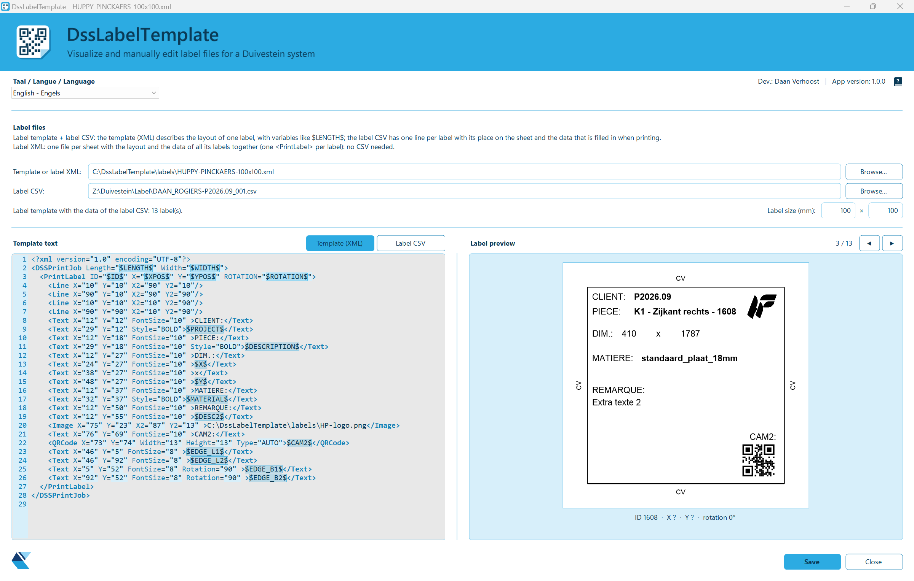

<h1 align="center"></h1>

A small Windows tool to **visualize, edit and print label files for a Duivestein system**.
Sister tool of **[TsDssConverter](https://github.com/Ruu-D/TsDssConverter)** (which writes the label CSV files for the Duivestein warehouse).

- **One single `.exe`**, no installer, no .NET installation needed, no Excel/Office.
- Opens the two kinds of Duivestein label files (DSS Software Interface v1.7):
  - a **label CSV + label template**: the CSV has one line per label (its place on the sheet and its data); the template
    (XML) describes the layout of one label with variables like `$LENGTH$` that are filled in from each CSV line;
  - a **label XML**: one file per sheet with the layout and the data of all its labels.
- Left: the XML in a coloured editor with line numbers (Scintilla, the editor of Notepad++), or the data of the label CSV
  as a table. Right: a preview of one label, updated while typing, with arrows to go through all labels, where the label
  sits on the sheet, and a small map of the sheet. The line between the two columns can be dragged.
- **Printing** on any Windows printer, meant for a label printer at the unloading belt (Zebra ZD220) to **reprint a
  damaged label**: the shown label, a range or all labels, one label per page, with real scannable QR codes and barcodes
  whose bars fall on whole printer dots. The automatic printing on the label station stays with Duivestein's
  DSSPrintServer.
- Dutch, French and English interface. Files are saved back in their own encoding and line endings.
- Installed by copying the exe to `C:\DssLabelTemplate`. That folder also holds `settings.json` and, from the first start,
  the example files in `labels\` and `CSV examples\`.

## Status

| Part | State |
|---|---|
| Window, file selection, text editor, open / save | Done (0.1.0, checked) |
| Both kinds of label files; label preview with arrows | Done (0.2.0) |
| Label size fields (length × width in mm, default 100 × 100); objects outside the label are flagged in color red | Done (0.3.0) |
| Program folder `C:\DssLabelTemplate` with examples; separate file lines for template and CSV; Tab order | Done (0.5.0, checked) |
| **First release** | **1.0.0** |
| Print button (reprint on a Zebra ZD220), real QR codes, draggable column divider, new banner text, touch-friendly layout | 1.1.0, customer test version; waiting for a test on the real printer |
| Window size / position / maximised and column divider remembered; label CSV shown as a table first | Done (1.1.1, published) |
| Sheet map can be turned (`SheetRotationInViewer` in `settings.json`), for a label PC on a turnable console | Done (1.1.2) |
| File description moved into "?" icons (hover or tap) and one divider removed: more height for the editor and preview | Done (1.1.2) |
| Big label CSV files open about 3 x faster, with a gray "loading" layer that blocks clicks meanwhile; wider arrow and print buttons (counter left, print right) | Done (1.1.2) |
| Zero-point dot on the sheet map; reference corner (`SheetReferenceCorner` in `settings.json`) matching TsDssConverter / DSSClient | Done (1.1.2 rebuild) |
| Preview 60 % label / 40 % sheet map; `ShowLabelRotation` and `PrintLabelWithRotation` in `settings.json` (turned preview / turned print of a square label) | Done (1.1.3) |
| Turned preview and print follow the operator's view (rotation + `SheetRotationInViewer`); `LabelDirection` (`CCW` / `CW`) in `settings.json` | Done (1.1.4) |

Third-party components: [Scintilla.NET](https://github.com/desjarlais/Scintilla.NET) (`Scintilla5.NET`, MIT licence) and
[QRCoder](https://github.com/Shane32/QRCoder) (MIT licence).

## Remarks

1. The preview follows Duivestein's manual. The label size is not in the label files, so it is set in the window.
2. The preview assumes (to be checked on a printed label): rotation counter-clockwise, text positioned by
its top-left corner.
3. QR codes are real and scannable. Barcodes are always printed as Code 128, whatever type the template names (EAN,
   Code 39, … are not built in).
4. The printer's paper size is set in the printer driver (Windows settings) to the label size; the program warns when
   it does not match the label size in the window.
5. The small sheet map below the label can be turned to match how the operator sees the sheet on the machine:
   `"SheetRotationInViewer": 90` in `settings.json` (0, 90, 180, 270 or the negative ones; positive = counter-clockwise).
   This setting is only in the file, not in the window.
6. A round dot on the sheet map marks the corner the label X / Y are measured from. Set that corner with
   `"SheetReferenceCorner": "Linksonder"` in `settings.json` (`Linksonder`, `Linksboven`, `Rechtsonder` or `Rechtsboven`,
   DSSClient's own names; only in the file). It must be the same corner as TsDssConverter's zero-point drop-down
   (= DSSClient's "Oriëntatie"), otherwise the sheet map shows the labels mirrored.
7. `"ShowLabelRotation": true` in `settings.json` turns the label PREVIEW by the label's rotation from the CSV (the way of
   `"LabelDirection": "CCW"` or `"CW"`, default CCW) plus `SheetRotationInViewer`, as the operator sees the label on the sheet; `"PrintLabelWithRotation": true`
   turns the PRINT the same way, around the middle of the label, so the operator can stick it on without turning it. Printing
   turned only works for a square label (length = width); for other sizes the program asks whether to print upright. Both are
   off by default and only in the file.
8. `"HideWindowsPrintDialog": true` in `settings.json` skips the Windows print dialog: the print button prints the shown label
   at once on `PrinterName` (if filled in and installed) or the default Windows printer, with the driver's own settings.
   Off by default and only in the file.

## Open questions

1. The real label size (mm) and a printed label to compare the preview with. Real-life printed labels can also determine if the label preview is rendered correctly.
2. Real templates, to be copied from a working Duivestein system later.
3. A test print on the Zebra ZD220: position, sharpness, and scanning the QR code and barcode with the real scanner.

Developer: Daan Verhoost — ROGIERS NV/SA.
