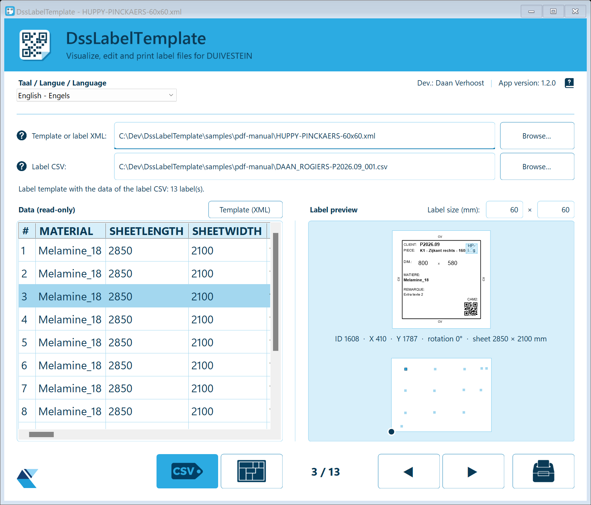
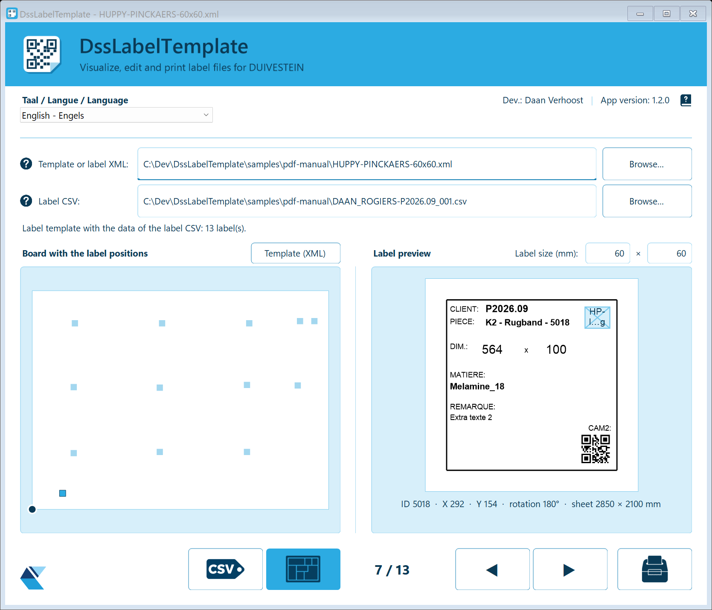

<h1 align="center"></h1>

**View, edit and reprint Duivestein label files.**

DssLabelTemplate is a small Windows tool for the label files of a Duivestein warehouse: it shows every label as it will be
printed, shows where it sits on the sheet, lets you edit the label layout, and reprints a damaged label at the unloading belt.
Sister tool: **[TsDssConverter](https://github.com/Ruu-D/TsDssConverter)** (writes the label CSV files for the warehouse).

> **Status:** version **1.2.0** (2026-11-08). Printing on the reprint printer (Zebra ZD220) works; real-world use at the
> customer is going on. Full history: [CHANGELOG.md](CHANGELOG.md).

## At a glance

- **One file**, `DssLabelTemplate.exe`: no installer, no .NET installation, no Excel or Office. It lives in
  `C:\DssLabelTemplate\`, together with `settings.json` and example label files.
- **Made for a touch screen:** big buttons, a large label preview, and a board view where a tap on a label shows it.
- **Dutch, French and English** interface.
- Files are saved back in their own encoding and line endings; the label CSV itself is never changed.

## What it looks like

Left the data of the label CSV (or the template text), right the label as it will be printed, with below it the sheet and
all its labels:

  

The two buttons below the left column switch between the **CSV table** and the **board view**. The board shows the whole
sheet with every label position; the label in the preview is highlighted, and tapping another label shows that one:

  

## What it does

- Opens the two kinds of Duivestein label files (DSS Software Interface v1.7):
  - a **label CSV + label template**: the CSV has one line per label (its place on the sheet and its data), the template
    (XML) describes the layout with variables like `$LENGTH$` that are filled in from each line;
  - a **label XML**: one file per sheet with the layout and the data of all its labels.
- **Edits** the XML in a coloured editor with line numbers (Scintilla, the editor of Notepad++); the preview follows while typing.
- **Previews** each label at its real proportions, with arrows to go through all labels, its position and rotation on the
  sheet, and a sheet map with the zero point of the warehouse.
- **Reprints** a damaged label on any Windows printer (made for a Zebra ZD220): the shown label, a range or all labels, with
  real scannable QR codes and barcodes. The automatic printing on the label station stays with Duivestein's DSSPrintServer.

## Main milestones

| Version | Date | |
|---|---|---|
| 1.0.0 | 2026-10-25 | First release: editor, label preview, both kinds of label files, program folder with examples |
| 1.1.0 | 2026-10-25 | **Printing** for the reprint station, real QR codes, touch-friendly layout |
| 1.1.2 | 2026-10-26 | Sheet map with the warehouse's zero point, turnable to the operator's view; big CSV files open much faster |
| 1.1.3 – 1.1.4 | 2026-10-26 / 27 | Turned preview and print, printing without the Windows dialog, CSV columns in your own order |
| 1.1.5 | 2026-11-08 | `settings.json` can be edited while the program runs (see below) |
| 1.2.0 | 2026-11-08 | **Board view** with tap-to-show, bigger touch buttons, adjustable CSV table size |

## Settings that are only in `settings.json`

The language and the label size are set in the window. Other settings are only in `C:\DssLabelTemplate\settings.json`:
**Shift+click on the ROGIERS logo** (bottom left of the window) opens it in Notepad. A saved change is used as soon as you
click back into the window, and is never overwritten by the program. The `README.md` in that folder explains each one.

| Setting | Default | Meaning |
|---|---|---|
| `PrinterName` | empty | The printer to use; empty = the default Windows printer |
| `HideWindowsPrintDialog` | `false` | `true` = the print button prints the shown label at once, without the Windows dialog |
| `ShowBoardByDefault` | `false` | `true` = every opened file is shown on the board |
| `RowHeightCSV` | `100` | Size of the text and rows of the CSV table, in percent (50 – 300) |
| `SheetReferenceCorner` | `Linksonder` | The corner the label positions are measured from; must match TsDssConverter and DSSClient |
| `SheetRotationInViewer` | `0` | Turns the sheet map to how the operator sees the sheet (0, 90, 180, 270 or negative) |
| `ShowLabelRotation` | `false` | `true` = the preview shows the label turned as it sits on the sheet |
| `PrintLabelWithRotation` | `false` | `true` = the print is turned the same way (square labels only) |
| `LabelDirection` | `CCW` | Which way a positive rotation turns: `CCW` or `CW` |

## Good to know

- The label size is not in the label files: it is set in the window (two fields above the preview).
- Barcodes are always printed as Code 128, whatever type the template names. QR codes are real and scannable.
- The paper size of the label printer is set in its driver (Windows settings); the program warns when it does not match.
  On the Zebra ZD220, switch dithering OFF in the driver.

## Open points

| From | Question |
|---|---|
| Customer | The real label size and a printed label to compare the preview with (position point, rotation direction) |
| Duivestein | The real label templates of the working system |
| Reprint station | Scanning the printed QR code and barcode with the real scanner |

## Technology

C# on .NET 10 with Windows Forms; [Scintilla.NET](https://github.com/desjarlais/Scintilla.NET) (`Scintilla5.NET`, MIT licence)
for the editor and [QRCoder](https://github.com/Shane32/QRCoder) (MIT licence) for the QR codes. 233 automated tests (xUnit).

## Credits

Developed by Daan Verhoost, together with my best friend Claude AI for [ROGIERS NV/SA](https://www.rogiers.be/).
